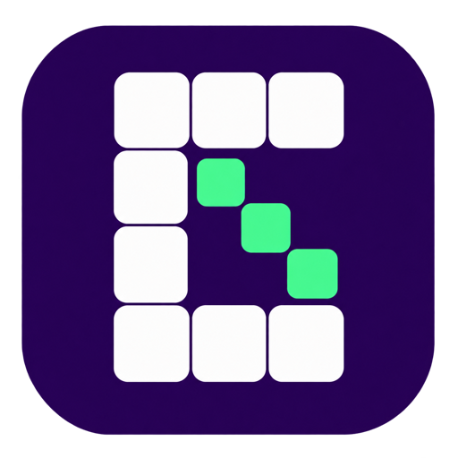
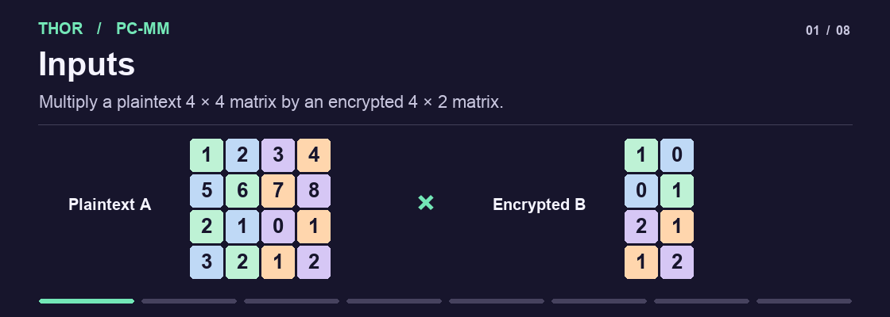
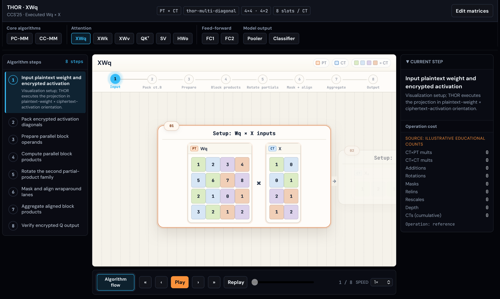
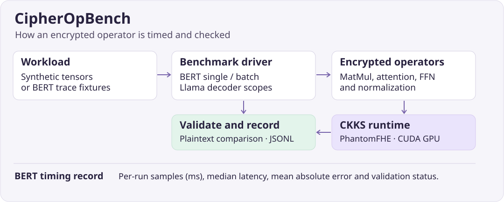
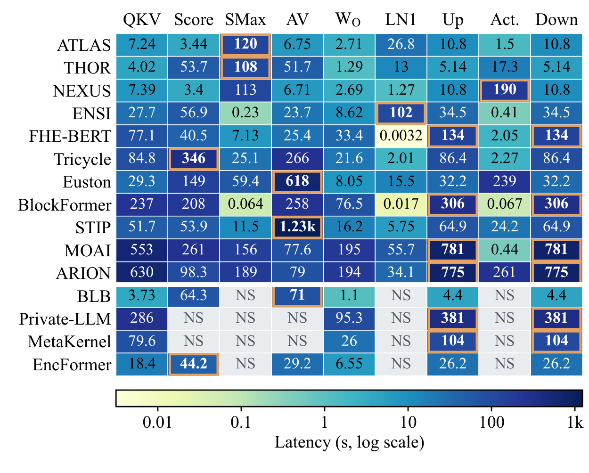
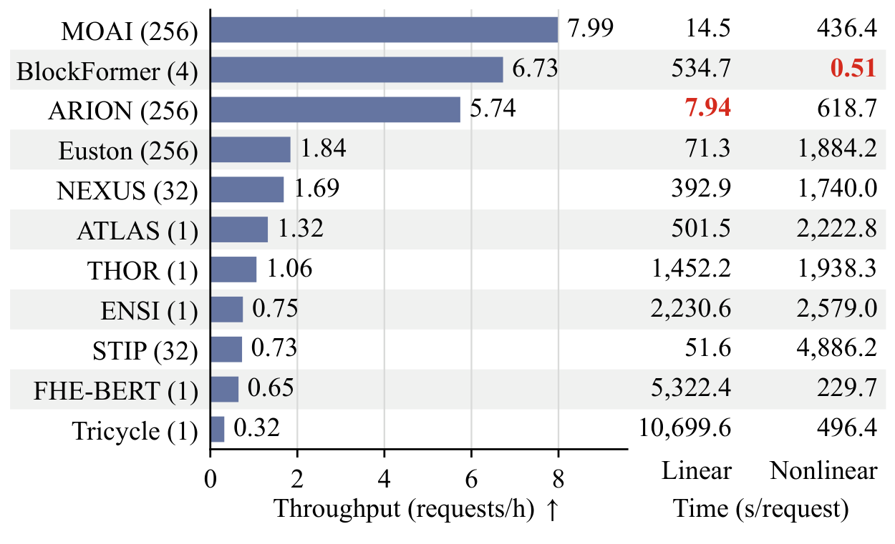
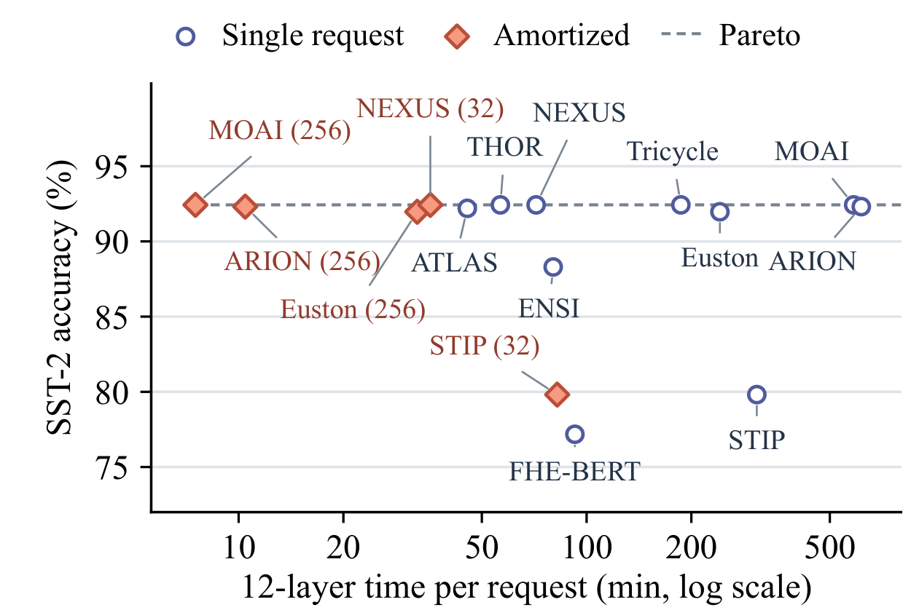
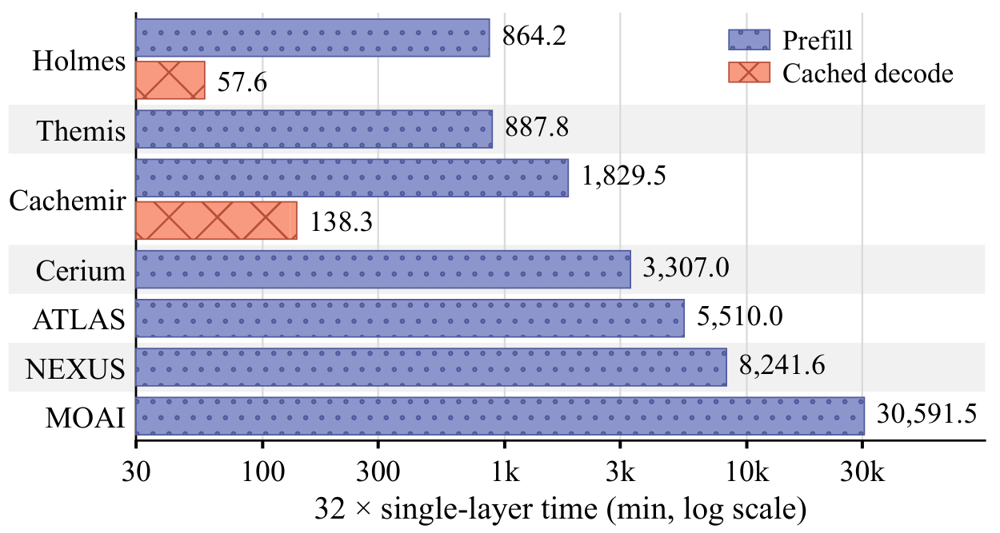

<p align="center">
  
</p>

<h1 align="center">CipherOpBench</h1>
<p align="center"><strong>Encrypted Transformer inference, operator by operator</strong></p>
<p align="center"><a href="#matrix-visualizer">Matrix visualizer</a> · <a href="#benchmark-library">Benchmark library</a> · <a href="#experimental-results">Experimental results</a> · <a href="literature-corpus.csv">Survey corpus</a></p>

How does a matrix entry move through a ciphertext, and how much does that layout cost on a GPU? This repository accompanies *SoK: Operator-Centric Analysis and Unified Benchmark of Privacy-Preserving Transformer Inference Based on Fully Homomorphic Encryption*. The **web visualizer** lets you follow matrix entries through packing, rotations and products. **CipherOpBench** measures encrypted operators and selected connected workloads at BERT-base and Llama-3-8B dimensions.



*THOR in eight steps.* The animation uses the visualizer’s own PC-MM trace for a $4\times4$ plaintext matrix and a $4\times2$ encrypted matrix. Follow the eight slots through rotation and masking. The last frame decodes them into the same matrix as the direct product.

## Matrix visualizer

From the repository root, start the site with Python 3.

```sh
python3 FHE-Transformer-Matmul-Visualizer/website/serve_visualizer.py
```

Open the [Matrix Visualizer](http://localhost:8000/transformer_visualizer.html). Select **THOR → PC-MM → Play** to replay the example above. Pause at **Step 2a** to see where a one-slot rotation sends each partial product. Use **Edit matrices** to change an entry and follow its effect on the output. The [Packing Lab](http://localhost:8000/visualizer.html) lets you inspect a layout string and its slot mapping directly.



*The THOR query-projection workspace from the SoK.* The method selector covers **THOR, MOAI, BLB, Cachemir, Euston, STIP and NEXUS**. Each trace shows the selected method’s layout and illustrative primitive counts. The browser simulates slot values. GPU timings come from the benchmark below.

## Benchmark library



| Workload | What you can run | Entry point |
| --- | --- | --- |
| BERT-base, one request | Time an operator such as $QK^\top$, or select a supported connected attention, FFN or encoder scope. Supply a trace fixture or use synthetic inputs. | [BERT driver](CipherOpBench/benchmarks/main.cu) |
| BERT-base, batched requests | Measure supported batched operators and inspect how packing across distinct requests changes cost per input. | [Operator batch driver](CipherOpBench/benchmarks/bert_operator_batch.cu) |
| Llama decoder | Profile decoder primitives such as RoPE. The separate unified Cachemir build also supports a connected layer with encrypted KV reuse. | [Decoder driver](CipherOpBench/benchmarks/decoder_main.cu) · [Cachemir layer](CipherOpBench/benchmarks/cachemir_gpu_layer.cu) |

**Run a GPU benchmark.** The reference build targets Linux x86-64 and an NVIDIA A100 with CUDA 12.4. Install CMake 3.26+, GCC, Git, Python 3, NTL, GMP and the C++11-ABI CPU distribution of LibTorch 2.6.0. Set `LIBTORCH_ROOT` to its installation directory. Start at the repository root.

```sh
cd CipherOpBench
./scripts/build_phantom.sh
cmake -S . -B build -DCMAKE_BUILD_TYPE=Release -DCMAKE_CUDA_ARCHITECTURES=80 \
  -DCMAKE_PREFIX_PATH="$PWD/.deps/phantom;$LIBTORCH_ROOT"
cmake --build build --parallel 2
build/bin/cipheropbench_bench --list
build/bin/cipheropbench_bench --method nexus --scope qk --warmup 1 --runs 3 --output bert.jsonl
```

The example evaluates scaled attention scores on synthetic inputs. In a completed timing record, inspect `samples_ms`, `median_ms`, `mae` and `status` together. The [build and run guide](CipherOpBench/README.md) describes trace fixtures, CPU-only checks and the separate unified decoder build.

## Experimental results

The four figures below come from the SoK evaluation on a single **NVIDIA A100 80 GB** per encrypted run. Timings average three synchronized runs after one warm-up and exclude input encryption, output decryption and correctness checks. Single-request latency, batch throughput and decoder projections answer different workload questions.

| Where does a BERT request spend time? | How does batching change throughput? |
| --- | --- |
| [](assets/bert-operator-latency.png) | [](assets/bert-batch-throughput.png) |
| On one 128-token SST-2 input, THOR takes **4.02 s** for QKV and **53.7 s** for attention scores. NEXUS takes **7.39 s** and **3.40 s** respectively. Outlines mark each row’s slowest operator. NS means unsupported. | At batch size 256, stage timings imply **7.99 requests/h** for MOAI and **5.74 requests/h** for ARION. Parentheses give the batch size. The two time columns show amortized linear and nonlinear work per request. |

| What does a given accuracy cost? | How do prefill and cached decode differ? |
| --- | --- |
| [](assets/bert-accuracy-latency.png) | [](assets/llama-prefill-decode.png) |
| THOR and NEXUS both match the exact BERT checkpoint on SST-2 in plaintext approximation tests. Their estimated encrypted 12-layer times for one request are **56.5 min** and **71.6 min**. Diamonds show time per input with a full batch. | A 128-token prefill builds the KV cache. One decode step appends a token to that cache. Bars project **32 × measured connected single-layer time**, excluding work between layers. Decode is shown only for methods with a matched cached run. |

The figures report the paper’s workloads. Reproducing specific paper values also requires the corresponding trace inputs, experiment launchers and backend builds. The source package provides the shared operators and selected connected drivers. The [survey corpus](literature-corpus.csv) records 92 entries across FHE-only, hybrid and MPC-only protocols.
